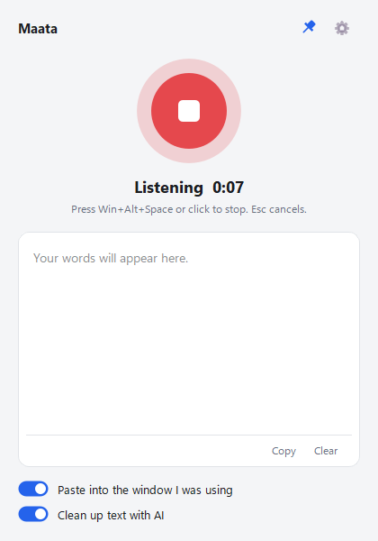
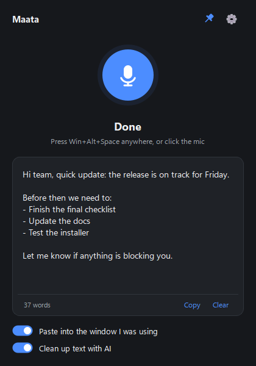
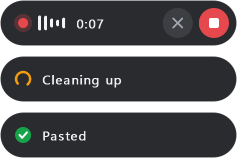
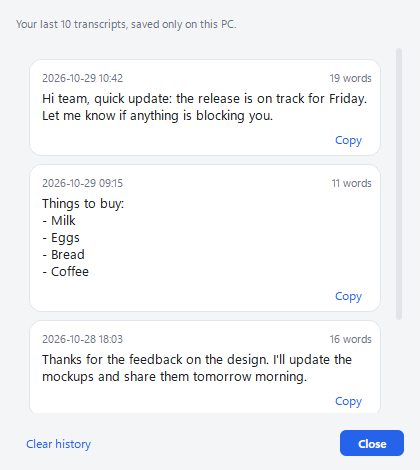

# 🎙️ Maata

*Maata (మాట) means "word" in Telugu.*

**Talk instead of type, in any Windows app.** Press a shortcut, speak, press it again, and your words appear where your cursor is: email, Word, Slack, your browser, anything.

Powered by OpenAI's speech recognition. Typical use costs **under $2 a month**, and you pay OpenAI directly with no subscription.

**A no-subscription alternative to Wispr Flow.** Like Flow, it types what you meant, not every "um" and "no wait" you said. There's no subscription: you pay OpenAI only for the minutes you use.

<p align="center">
  
  &nbsp;&nbsp;
  
</p>

---

## ⬇️ Download and start in 3 minutes

### 1. Download

**[Download Maata.exe](../../releases/latest/download/Maata.exe)** (Windows 10 or 11, about 58 MB)

No installer. It's a single file you can run from anywhere.

### 2. Open it

Double-click `Maata.exe`.

Windows may show **"Windows protected your PC"**. That's normal for free apps from independent developers that haven't paid for a code-signing certificate. Click **More info**, then **Run anyway**.

### 3. Add your OpenAI API key

The first time it opens, Maata asks for an OpenAI API key, which is how you pay for the speech recognition.

1. Sign in at **[platform.openai.com](https://platform.openai.com/)** (it's a different account from ChatGPT Plus).
2. Go to **Settings → Billing** and add some credit. $5 is the minimum and lasts most people months.
3. Go to **[API keys](https://platform.openai.com/api-keys)**, click **Create new secret key**, and copy it. It starts with `sk-`.
4. Paste it into Maata's **OpenAI API key** box and click **Save**.

Your key stays on your PC. See [Privacy](#-privacy).

### 4. Dictate

1. Click into any text box, anywhere.
2. Press **Win + Alt + Space** and speak.
3. Press **Win + Alt + Space** again.

While you talk, a small bar at the bottom of your screen shows that Maata is listening. Press **Esc** to cancel.

<p align="center">
  
</p>

A few seconds later your text appears in the window. Turn on **Paste into the window I was using** to have it typed straight into the app you were in, and **Clean up text with AI** to remove "um"s and fix punctuation.

> **Tip:** close the window and Maata keeps running in the system tray (near the clock), so the shortcut works all day. If you can't see the icon, click the **^** arrow and drag the icon onto the taskbar.

> **Tip:** to start it with Windows, press **Win + R**, type `shell:startup`, press Enter, and put a shortcut to `Maata.exe` in that folder.

---

## ✨ Features

- **Works in every app.** One global shortcut (**Win + Alt + Space**), from any window.
- **Pastes where you were typing**, then restores whatever you had copied before.
- **AI cleanup (optional).** Removes "um", "uh" and repeated words, keeps only your correction when you change your mind ("at 3, no, at 4"), fixes punctuation and turns spoken lists into bullet points.
- **Floating recording bar** at the bottom of the screen with a timer and voice level, plus stop and cancel buttons. It never steals focus from the app you're typing in.
- **Never lose a recording.** If the internet or OpenAI fails, the audio is kept and you can click **Retry**, even after restarting Maata.
- **Esc cancels** a recording you don't want, so it isn't sent or billed.
- **Skips long pauses** before uploading, so you don't pay for silence while you think.
- **History** of your last 10 transcripts, so you can copy an earlier one again. It's kept only on your PC.
- **Start and stop sounds**, so you know it heard the shortcut without looking.
- **Update notice** when a new version is out.
- **Accurate.** Uses OpenAI's GPT-4o transcription models and handles 50+ languages, including Hindi, Telugu, Tamil and more.
- **Custom words.** Teach it names and jargon so they're spelled right.
- **Lives in the tray.** The icon turns blue when ready, red while listening and amber while transcribing.
- **Visual feedback.** The mic button glows with your voice, with a live timer.
- **Light and dark mode** follow your Windows setting.
- **Pin on top**, copy, clear and a word count.
- Recordings up to **13 minutes**.

<p align="center">
  <picture>
    <source media="(prefers-color-scheme: dark)" srcset="docs/history-dark.png">
    
  </picture>
</p>

---

## 💰 Cost

Maata itself is **free**. You only pay OpenAI for the audio you transcribe, billed to your own account.

| Model (choose in Settings) | Per minute | $5 of credit lasts |
|---|---|---|
| **GPT-4o mini Transcribe** (default, recommended) | $0.003 | ~28 hours of speech |
| GPT-4o Transcribe (most accurate) | $0.006 | ~14 hours |
| Whisper (original) | $0.006 | ~14 hours |

**AI cleanup** (optional) uses GPT-4o mini and adds about **$0.0002 per minute**, under 10% extra.

### What that looks like (default model)

| How much you dictate | Cost |
|---|---|
| One 30-second message | $0.0015 (a sixth of a cent) |
| 10 minutes a day | **~$0.66 / month** |
| 30 minutes a day | **~$1.98 / month** |
| 1 hour a day | **~$3.96 / month** |

*Monthly figures assume 22 workdays. Prices checked October 2026; see [OpenAI pricing](https://openai.com/api/pricing/) for current rates.*

**Keeping costs down:**
- Leave **Skip long pauses** on (the default). Silence is billed like speech, so Maata cuts long pauses out before uploading. It still helps to stop recording when you finish talking.
- Stay on the default model. It's half the price and very accurate.
- Set a monthly budget in your OpenAI account under **Settings → Limits** so there are never surprises. A single recording can't exceed 13 minutes, about $0.04.

---

## ⚙️ Settings

Click **⚙** in the window, or right-click the tray icon and choose **Settings...**

| Setting | What it does |
|---|---|
| **OpenAI API key** | Your key, stored only on your PC |
| **Hotkey** | The start/stop shortcut. Default `win+alt+space`. Modifiers: `ctrl`, `alt`, `shift`, `win`. Keys: `a`-`z`, `0`-`9`, `f1`-`f24`, `space` |
| **Microphone** | Which mic to use. Default: your system's default mic |
| **Language** | Set it if you always speak one language, for better accuracy. Default: detect automatically |
| **Model** | GPT-4o mini (default), GPT-4o or Whisper |
| **Custom words** | Names or terms to spell correctly, e.g. `Kubernetes, Priya, Hyderabad` |
| **Sounds** | A soft sound when recording starts and stops. Default: on |
| **Skip long pauses** | Cuts pauses longer than about half a second before uploading, which makes it cheaper. Default: on |
| **History** | Remembers your last 10 transcripts on this PC. Turning it off deletes the saved ones. Default: on |
| **Update notice** | Tells you when a new version is on GitHub. Default: on |

In the main window, the **📌** pin keeps it above other windows, the **🕘** clock button opens your History, and the two switches turn auto-paste and AI cleanup on or off.

<details>
<summary>Why Win + Alt + Space?</summary>

It isn't used by Windows, Office or browsers. The usual alternatives clash with something:

| Shortcut | Already used by |
|---|---|
| Ctrl + Alt + Space | Claude desktop and other launcher apps |
| Ctrl + Shift + Space | Word (non-breaking space) |
| Ctrl + Win + Space | Windows (switch keyboard language) |
| Alt + Space | Windows window menu, PowerToys Run |

If it's taken on your PC, Maata uses **Ctrl + Win + Alt + Space** instead and tells you. You can pick any shortcut in Settings.
</details>

---

## 🔒 Privacy

- Your recording goes **directly from your PC to OpenAI** to be transcribed. There's no other server in between.
- Your API key and settings are stored only on your PC, in `%APPDATA%\Maata\settings.env`.
- Your last 10 transcripts are saved only on your PC, in `%APPDATA%\Maata\history.json`. You can clear them in **History**, or turn history off in Settings.
- Maata has no analytics, tracking or accounts. The only other connection it makes is a once-a-day check with GitHub for a newer version, which sends nothing about you. You can turn that off in Settings.
- OpenAI's API doesn't use your audio to train its models by default. See [OpenAI's data policy](https://openai.com/enterprise-privacy/).

---

## ✍️ Code signing policy

Free code signing provided by [SignPath.io](https://about.signpath.io), certificate by [SignPath Foundation](https://signpath.org).

- **Committers and reviewers:** [srushith](https://github.com/srushith)
- **Approvers:** [srushith](https://github.com/srushith)

Every signed release is built from this repository's source by GitHub Actions. Nothing built on a personal PC is signed.

See [Privacy](#-privacy) for what data Maata sends and where.

---

## 🛠️ Troubleshooting

| Problem | Fix |
|---|---|
| "Windows protected your PC" | Click **More info**, then **Run anyway** (see step 2) |
| Antivirus flags the file | A known false alarm for Python-built apps. You can check the source code here, or build it yourself (see below) |
| "Couldn't transcribe" | Your recording is saved. Fix the problem shown (internet, credit or key), then click **Retry**. The text is copied to your clipboard |
| "OpenAI rejected the API key" | Re-copy the key into Settings, and make sure your OpenAI account has credit |
| "No audio was captured" or the mic glow doesn't move | Pick your mic in Settings, and check **Windows Settings → Privacy → Microphone → Let desktop apps access your microphone** |
| The shortcut does nothing | Another app may use it. Choose a different one in Settings |
| Text didn't paste | It's still on your clipboard, so press **Ctrl + V**. Some apps running as administrator block pasting from normal apps |
| Can't find the window | Click the tray icon near the clock (check the **^** arrow) |

---

## 🗑️ Uninstall

1. Right-click the tray icon and choose **Quit**.
2. Delete `Maata.exe`.
3. Optionally, delete your saved settings and history: press **Win + R**, type `%APPDATA%\Maata`, and delete that folder.

---

## 👩‍💻 For developers

### How it works

```
Hotkey ──► record mic (16 kHz) ──► OpenAI transcription ──► optional AI cleanup ──► paste into the window you were in
```

- **Hotkey:** registered with the Windows `RegisterHotKey` API, so no keyboard hooks are needed.
- **Audio:** recorded at 16 kHz, 16-bit mono, which is what speech models use. That's about 5× smaller than CD quality, so uploads are fast and 13 minutes fits under OpenAI's 25 MB limit.
- **Cleanup:** an optional pass through GPT-4o mini with instructions to tidy the text without changing its meaning, or answering anything in it.
- **Skipping pauses:** the audio is split into 30 ms slices. Slices well above the room's background level count as speech, and pauses are shortened to about 0.2 s while keeping a quarter second around every word.
- **Reliability:** each recording is saved to `%TEMP%\Maata` and deleted once transcribed, so a failed one can be retried. Only one copy of Maata runs at a time.
- **Pasting:** the app remembers the window you were in, switches back to it, presses Ctrl+V and then restores your clipboard.

### Run from source

Requires Python 3.9+ on Windows.

```powershell
git clone <this repo>
cd maata
python -m venv .venv
.venv\Scripts\activate
pip install -r requirements.txt
python main.py
```

When running from source, settings (including the API key) are read from a `.env` file in the project folder, which the app creates on first run. `.env` is in `.gitignore`, so it's never committed.

### Build the .exe

```powershell
pip install pyinstaller
pyinstaller main.spec
```

The output is `dist\Maata.exe`, a single file with no Python needed on the target PC.

### Project structure

| File | Purpose |
|---|---|
| `main.py` | Entry point |
| `ui.py` | Main window, tray icon, global hotkey, recording flow |
| `widgets.py` | Round record button, toggle switch, icons |
| `overlay.py` | Floating recording bar |
| `theme.py` | Light and dark colors and styles |
| `settings_dialog.py` | Settings window |
| `settings.py` | Loads and saves settings (`.env` from source, `%APPDATA%` for the .exe) |
| `hotkey.py` | Hotkey parsing and defaults |
| `recorder.py` | Microphone recording and pause trimming |
| `transcriber_api.py` | OpenAI transcription (with language and custom-word hints) and AI cleanup |
| `history.py`, `history_dialog.py` | Saves the last 10 transcripts and shows the History window |
| `sounds.py` | Start, stop and cancel sounds |
| `updater.py`, `version.py` | Version number and the check for new releases |
| `typer.py` | Switches to the target window, pastes and restores the clipboard |
| `main.spec`, `version_info.txt` | PyInstaller build settings |
| `assets/icon.ico` | App icon |
| `docs/` | Screenshots for this README |

---

Made with ☕ and Python. If Maata saves you some typing, a ⭐ on the repo is appreciated.
